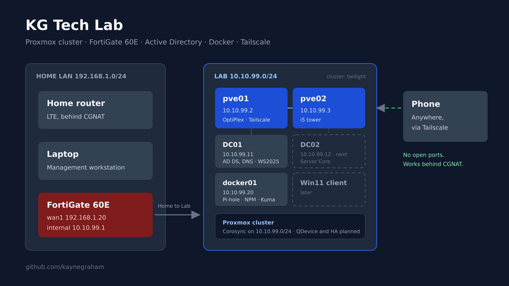

# KG Tech Lab


Home lab for learning Windows Server, Active Directory, Linux, Docker and networking. Built on a two node Proxmox cluster behind a FortiGate 60E, with each step documented as I go.

## Quick links

| Page | What's in it |
|---|---|
| [Hardware](docs/hardware.md) | Host specs, current limits and the upgrade plan |
| [Network](docs/network.md) | IP plan, firewall rules, routing and remote access |
| [Build log](#build-log) | Step by step write-ups of everything built so far |

## At a glance

- **Hypervisors:** Proxmox VE 9 cluster `twilight`, pve01 (Dell OptiPlex 7040 SFF) and pve02 (i5 desktop tower)
- **Firewall:** FortiGate 60E
- **Domain:** `lab.twilight` (NetBIOS `TWILIGHT`)
- **Lab subnet:** `10.10.99.0/24`
- **Remote access:** Tailscale on the Proxmox host
- **Services:** Uptime Kuma, Portainer, Homarr, Pi-hole, Nginx Proxy Manager and a custom lab-stats panel on docker01
- **Web UIs:** `https://<service>.twilight.goaround.lol`, real Let's Encrypt wildcard cert

## Network

```
Home router (192.168.1.0/24)
  |
  |-- Laptop 192.168.1.120 (static)
  |
  |-- FortiGate wan1 192.168.1.20
        |
        FortiGate internal 10.10.99.1
        |
        Lab subnet 10.10.99.0/24
          |-- pve01    10.10.99.2
          |-- pve02    10.10.99.3
          |-- DC01     10.10.99.11
          |-- docker01 10.10.99.20
```

Full details in [network.md](docs/network.md).

## Build log

| # | Topic | Status |
|---|---|---|
| 01 | [Network access to the lab](docs/01-network-access.md) | Done |
| 02 | [Remote access with Tailscale](docs/02-tailscale-remote-access.md) | Done |
| 03 | [DC01: first domain controller](docs/03-dc01.md) | Done |
| 04 | [Docker host: Uptime Kuma, Portainer, Homarr, Pi-hole, custom clock and stats panel](docs/04-docker-host.md) | Done |
| 05 | [Reverse proxy and HTTPS: Nginx Proxy Manager, wildcard cert](docs/05-reverse-proxy.md) | Done |
| 06 | [pve02 and a two node cluster](docs/06-pve02-cluster.md) | Done |
| 07 | DC02: second domain controller (Server Core) on pve02 | Next |
| 08 | QDevice and replicated storage, HA for docker01 | Planned |
| 09 | Cloudflare Tunnel and Access: public status page | Planned |
| 10 | Windows 11 client, OUs and GPOs | Planned |
| 11 | AD Certificate Services (internal CA) | Planned |
| 12 | WireGuard inside the lab | Planned |

## To do

- [x] Order RAM (2x8GB DDR4-2133), see [hardware](docs/hardware.md)
- [ ] Rerun Windows Update on DC01 (running), then `dcdiag /q` once old errors age out
- [x] Add the 10.10.99.0/24 static route on the home router
- [x] Turn on logging for the FortiGate implicit deny rule
- [x] Remove the leftover `ts01` container (VM 100)
- [x] Approve the 10.10.99.0/24 subnet route in Tailscale
- [ ] Switch lab-stats to `/cluster/resources` so it shows both nodes
- [ ] DHCP reservation for the Mac on the home router

## Rules for this repo

- No passwords, keys or real public IPs.
- Nothing from work or clients.
