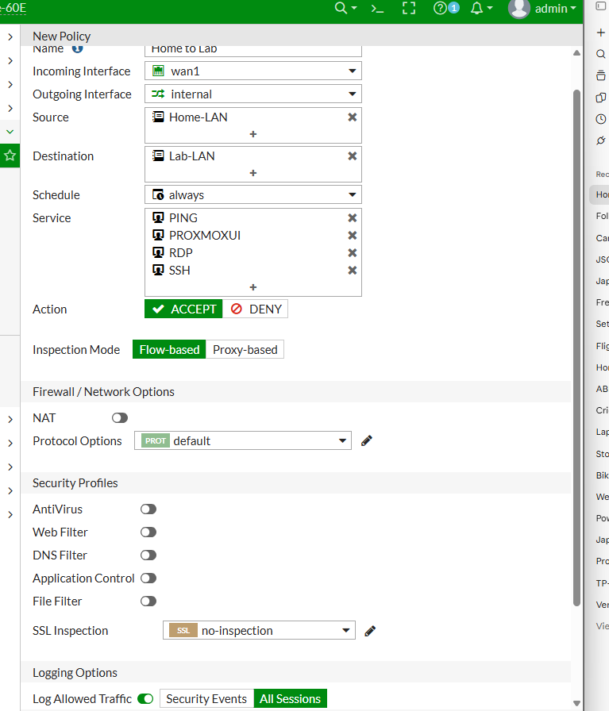
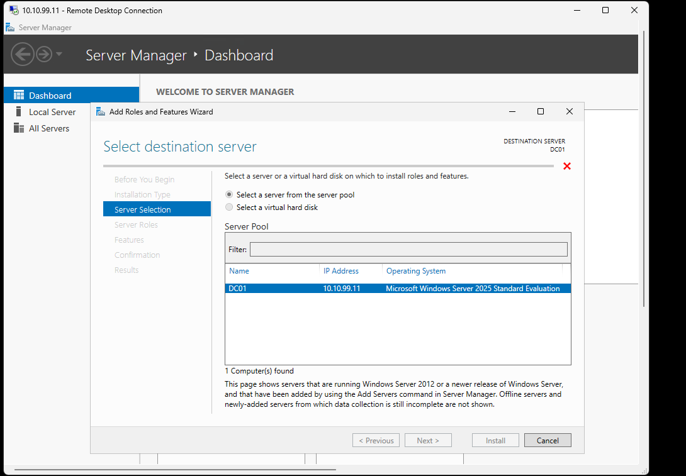
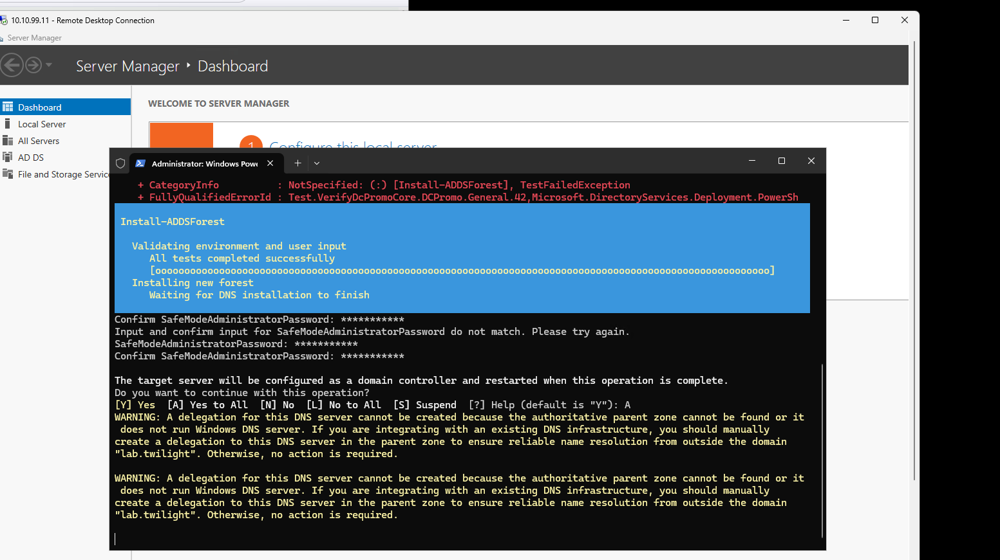
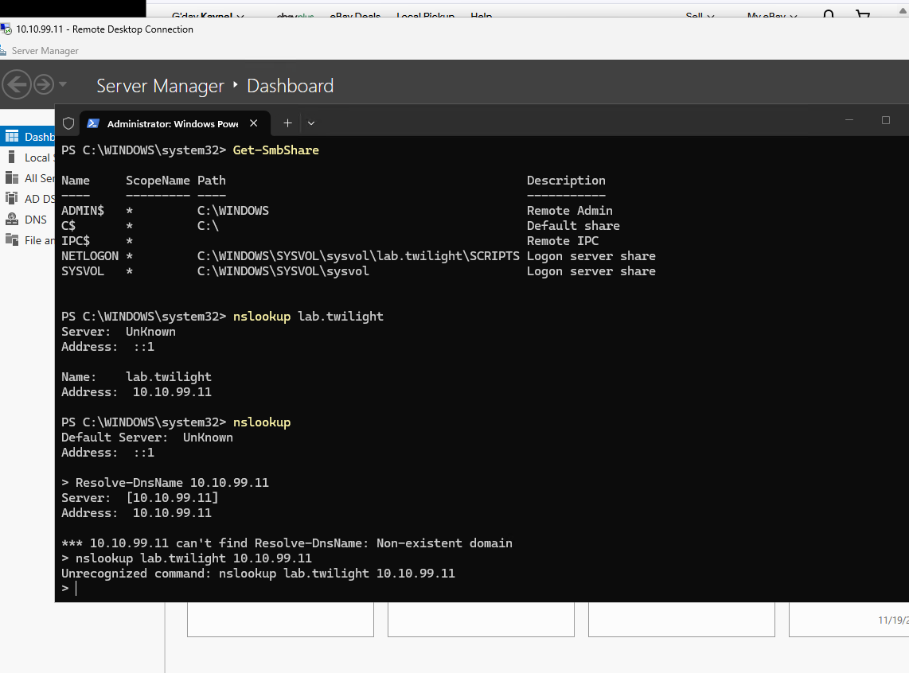

# 03: DC01, first domain controller

[Back to README](../README.md) · Previous: [02](02-tailscale-remote-access.md)

> Status: done

## Goal

Build the first domain controller for the `lab.twilight` forest.

## Domain details

| Setting | Value |
|---|---|
| Domain (FQDN) | lab.twilight |
| NetBIOS name | TWILIGHT |
| DC01 IP | 10.10.99.11/24 |
| Gateway | 10.10.99.1 |

## IP plan

| Device | IP |
|---|---|
| FortiGate (internal) | 10.10.99.1 |
| pve01 | 10.10.99.2 |
| DC01 | 10.10.99.11 |
| DC02 | 10.10.99.12 |
| Docker host | 10.10.99.20 |

## VM settings

| Tab | Setting |
|---|---|
| General | VM ID 101, name DC01 |
| OS | Windows Server 2025 eval ISO, type Microsoft Windows 11/2022/2025, VirtIO drivers ISO attached |
| System | q35, OVMF (UEFI), EFI disk, TPM 2.0, VirtIO SCSI single, QEMU agent on |
| Disk | SCSI, 60GB, discard and SSD emulation on |
| CPU | 2 cores, type x86-64-v2-AES |
| Memory | 3GB, ballooning off |
| Network | vmbr0, VirtIO, Proxmox firewall off |

## Install

1. Boot from the Server 2025 ISO and pick Standard Evaluation (Desktop Experience).
2. Load the storage driver from the VirtIO ISO (`vioscsi\2k25\amd64`) so the disk shows up.
3. After install, run `virtio-win-guest-tools.exe` from the VirtIO ISO for the network driver and QEMU guest agent.
4. Rename to DC01, set the static IP, timezone Perth.
5. Shut down and take a `pre-adds` snapshot (RAM not included).

## Remote access (RDP)

Enabled Remote Desktop in Settings, which also opens the Windows firewall rule.

Replaced the laptop-only FortiGate rule with one rule for the whole home network:

| Field | Value |
|---|---|
| Name | Home to Lab |
| Incoming / Outgoing | wan1 / internal |
| Source | Home-LAN (192.168.1.0/24) |
| Destination | Lab-LAN (10.10.99.0/24) |
| Services | PING, PROXMOXUI, RDP, SSH |
| NAT | Off |
| Logging | All sessions |



Other devices at home also need a static route on the home router: 10.10.99.0/24 via 192.168.1.20.

## Promotion

Installed the AD DS role through Server Manager.



Server Manager kept hanging on "Collecting data", so the role and promotion were done in PowerShell:

```
Install-WindowsFeature AD-Domain-Services -IncludeManagementTools
Install-ADDSForest -DomainName "lab.twilight" -DomainNetbiosName "TWILIGHT" -InstallDns
```

The role install asked for a restart before promotion. The DNS delegation warnings during promotion are expected for a new forest that isn't part of a public domain.



## Post-promotion config

```
Get-DnsClientServerAddress -AddressFamily IPv4
Add-DnsServerForwarder -IPAddress 1.1.1.1
w32tm /config /manualpeerlist:"au.pool.ntp.org" /syncfromflags:manual /reliable:yes /update
Add-DnsServerPrimaryZone -NetworkId "10.10.99.0/24" -ReplicationScope Forest
ipconfig /registerdns
```

| Setting | Result |
|---|---|
| DC01 DNS client | 127.0.0.1 (set by promotion) |
| DNS forwarder | 1.1.1.1 (already present after promotion) |
| Time source | au.pool.ntp.org, DC01 marked as reliable |
| Reverse lookup zone | 99.10.10.in-addr.arpa |

## Health checks

| Check | Result |
|---|---|
| `Get-SmbShare` | SYSVOL and NETLOGON shared |
| `nslookup lab.twilight` | Resolves to 10.10.99.11 |
| `Resolve-DnsName 10.10.99.11` | Resolves to DC01.lab.twilight |
| `ping google.com` | Replies, forwarder working |
| `dcdiag /q` | SystemLog and DFSREvent failed on old events (see below) |



### About the dcdiag failures

Both failures came from errors already sitting in the event log, not a live fault:

- Windows Update install failures from the first boot.
- A burst of service crashes during the post-promotion reboot.
- RID allocator errors at first boot, before the RID pool was assigned.

The SystemLog test looks back 24 hours, so it keeps failing until those age out. Rerun `dcdiag /q` the next day after Windows Update has finished.

### nslookup shows "Server: UnKnown"

`nslookup` queries `::1` (IPv6 loopback) first, and there's no PTR record for `::1`. It's cosmetic. Don't disable IPv6 on a DC to hide it: Microsoft doesn't support DCs with IPv6 turned off. Running `nslookup` with no arguments drops into interactive mode (`>` prompt); type `exit` to leave.

## Issues hit

| Problem | Cause | Fix |
|---|---|---|
| VM fell through to PXE boot | Missed the "press any key to boot from CD" prompt | Open the console before starting and tap a key straight away. Untick net0 in boot order. |
| BSOD `PAGE_FAULT_IN_NONPAGED_AREA` during setup | CPU type set to `host` | Changed CPU type to `x86-64-v2-AES`. Needs a full Stop and Start, not a reboot, to apply. |
| Reboot from Proxmox failed | Windows was stuck on the BSOD and couldn't respond | Used Stop (hard power off) instead |
| No network adapter in Windows | VirtIO network driver not installed | Ran `virtio-win-guest-tools.exe` from the VirtIO ISO |
| Server Manager and `Install-WindowsFeature` stuck on "Collecting data" | Windows servicing stack busy with first-boot updates | Waited, restarted when prompted, then ran it in PowerShell |
| Earlier `Install-ADDSForest` run threw `TestFailedException` | Prerequisite checks failed, most likely the pending restart from the role install | Restarted, reran. DSRM password prompt also needed a retry after a mismatch. |
| Snapshot hung on `savevm-end` | "Include RAM" ticked, writing 3GB of memory to disk | Stopped the task, `qm unlock 101`, `qm delsnapshot 101 pre-adds --force`, then snapshotted with the VM shut down and RAM unticked |

## Lessons

- Use `x86-64-v2-AES` as the CPU type for Windows Server 2025 on this host.
- Windows on Proxmox needs the VirtIO drivers twice: storage during install, network after.
- Take DC snapshots with the VM shut down. Once there are two DCs, never roll a DC back from a snapshot.
- Don't point a server's DNS at itself until it actually runs DNS.
- A fresh Windows Server install is slow for the first few hours while updates, .NET and Defender run. Host RAM and disk make it worse (see [hardware](hardware.md)).
- `dcdiag` reads the event log, so errors from setup can fail tests even when everything is healthy.

## Next

04: DC02, once the RAM upgrade is in.
