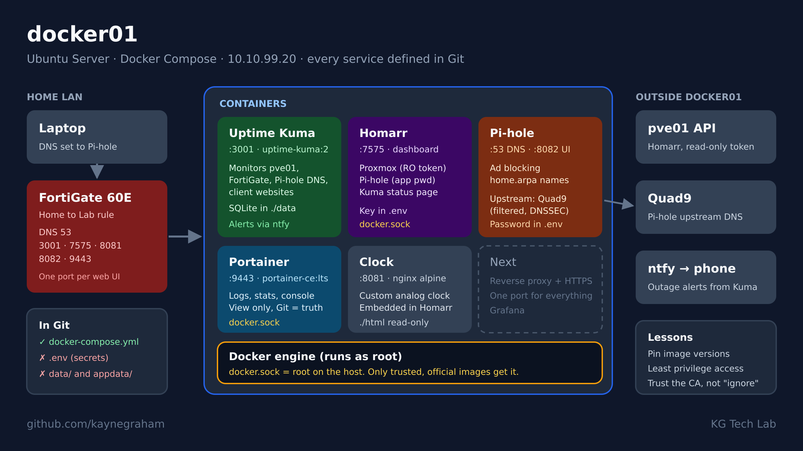
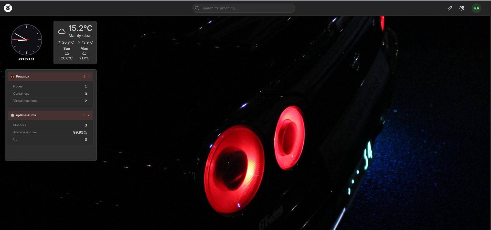
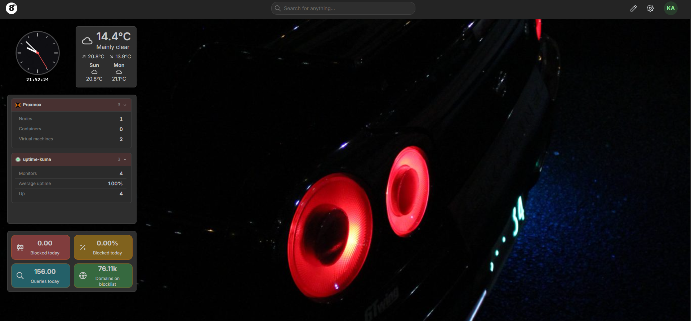

# 04: Docker host

[Back to README](../README.md) · Previous: [03](03-dc01.md)

> Status: done

## Goal



Build a Linux VM that runs containers with Docker Compose, then run Portainer, Uptime Kuma, Homarr and Pi-hole on it. Every service is defined in a compose file in this repo, so the whole host can be rebuilt from Git.

## How to use this page

This is a guided build, not a copy and paste. Each step has:

- **Why:** the reason the step exists
- **Figure out:** what to look up or work out yourself
- **Check:** how to prove it works
- **Notes:** questions to answer in your own words once it's done. Replace them with your answers, since that's what makes this page worth reading.

---

## Step 1: Create the VM

**Why:** Docker runs in a VM rather than an LXC. Proxmox recommends this, because Docker inside an unprivileged LXC needs extra permissions and tends to break after Proxmox updates. A VM is fully isolated with its own kernel.

**Figure out:**
- Debian 12 or Ubuntu Server 24.04. Pick one and write down why.
- Specs: 2 cores, 3 to 4GB RAM, 40GB disk, IP `10.10.99.20`. DC01 is shut down to free RAM.
- How to set a static IP on your chosen distro. Debian and Ubuntu do it differently (`/etc/network/interfaces` vs netplan).

**Check:** from your laptop, `ssh <user>@10.10.99.20` works and `ping 1.1.1.1` works from the VM.

### What I built ✅

| Setting | Value |
|---|---|
| Name | docker01 |
| OS | Ubuntu Server LTS |
| CPU / RAM / Disk | 2 cores, 4GB (ballooning on), 40GB (discard, SSD emulation) |
| Network | vmbr0, VirtIO, interface `ens18` |
| IP | 10.10.99.20/24, gateway 10.10.99.1 |
| DNS | 1.1.1.1, 8.8.8.8 (temporary, DC01 is off) |
| QEMU agent | On in Proxmox, `qemu-guest-agent` installed in Ubuntu |

Static IP set in the Ubuntu installer. OpenSSH installed, no snaps. DC01 shut down cleanly from Windows to free RAM.

Post-install:

```
sudo apt update && sudo apt upgrade
sudo apt install qemu-guest-agent
systemctl status qemu-guest-agent
ip addr show ens18
```

Gotchas:
- First try at the name servers field was missing the comma (`1.1.1.1.8.8.8.8`). It has to be `1.1.1.1,8.8.8.8`.
- `ip addr show` takes an interface name (`ens18`), not an IP.
- `systemctl enable qemu-guest-agent` warns that the unit is static. That's normal on Ubuntu: it starts automatically when Proxmox's agent device is attached.
- To do: point DNS at Pi-hole (and DC01) once they're running.

**Notes:**
- Why a VM and not an LXC for Docker?
- Why does the FortiGate already allow SSH to this VM without a new rule?

---

## Step 2: Install Docker and Compose

**Why:** use Docker's official repository, not the distro package. The distro version is often old and doesn't include the Compose plugin.

**Figure out:**
- Docker's official install guide for your distro (docs.docker.com).
- What the `docker` group does, and whether to add your user to it.

**Check:** `docker run hello-world` and `docker compose version` both work.

### What I did ✅

Installed from Docker's apt repository, following the official guide.

| Command | What it does |
|---|---|
| `apt install ca-certificates curl` | `curl` downloads files. `ca-certificates` lets the VM verify HTTPS sites. |
| `install -m 0755 -d /etc/apt/keyrings` | Creates a folder for trusted signing keys |
| `curl ... gpg -o /etc/apt/keyrings/docker.asc` | Downloads Docker's public signing key |
| `chmod a+r` | Makes the key readable so apt can use it |
| `tee /etc/apt/sources.list.d/docker.sources` | Tells apt where Docker's repo is |
| `$(. /etc/os-release ...)` | Fills in the Ubuntu codename so the right packages are used |
| `$(dpkg --print-architecture)` | Fills in the CPU architecture (amd64) |
| `Signed-By:` | Only trust packages from this repo if signed with Docker's key |
| `apt install docker-ce docker-ce-cli containerd.io docker-buildx-plugin docker-compose-plugin` | Engine, CLI, container runtime, image builder and Compose |

Why the GPG key matters: apt checks every package from the repo was signed by Docker. A tampered download wouldn't match the signature, and apt would refuse it.

Result: `sudo docker run hello-world` works, `docker compose version` returns v5.8.0.

**Notes:**
- Adding a user to the `docker` group is effectively giving them root. Why?
- What's the difference between an image and a container?

---

## Step 3: Repo layout

**Why:** one folder per service, each with its own `docker-compose.yml`. You can start, stop and update services on their own, and the repo becomes your backup of how everything is configured.

```
docker/
  portainer/docker-compose.yml
  uptime-kuma/docker-compose.yml
  homarr/docker-compose.yml
  pihole/docker-compose.yml
```

Clone the repo onto the VM and run each service from its own folder.

**Notes:**
- Why keep compose files in Git instead of just running `docker run` commands?

---

## Step 4: Uptime Kuma (worked example)

This one is done for you, line by line, so you can see the pattern. Write the rest yourself using it as a reference.

```yaml
services:
  uptime-kuma:
    image: louislam/uptime-kuma:2
    container_name: uptime-kuma
    restart: unless-stopped
    ports:
      - "3001:3001"
    volumes:
      - ./data:/app/data
```

| Line | What it does | Why it matters |
|---|---|---|
| `image: louislam/uptime-kuma:2` | The image to run, pinned to major version 2 | `:latest` can jump to a new major version and break things on an update. Pinning makes updates deliberate. |
| `container_name` | A fixed name instead of a random one | Easier to find in `docker ps` and logs |
| `restart: unless-stopped` | Restarts the container if it crashes or the VM reboots, unless you stopped it yourself | Without it, services stay down after a reboot |
| `ports: "3001:3001"` | Host port on the left, container port on the right | Containers are isolated by default. This opens one port from the VM into the container. |
| `volumes: ./data:/app/data` | Maps a folder on the VM into the container | Containers are disposable. Anything not in a volume is lost when the container is recreated, including all your monitors. |

**Check:** `docker compose up -d`, then browse to `http://10.10.99.20:3001`. Is it reachable from your laptop? If not, which device is blocking it, and what would you change?

**Then:** add monitors for pve01, the FortiGate, DC01 and a few Built for Perth client sites. Set up a notification to your phone.

### What I did ✅

- Started on the `:1` tag, then moved to `:2` (current major version) before adding any monitors. Deleted `./data` and started fresh, since upgrading later means a database migration.
- Picked **SQLite** at the v2 database setup: lowest RAM, and the whole database is one file in `./data`, so backups are just copying the folder.
- Browser showed `Socket.io connect_error` after the upgrade because it had cached the v1 page. An incognito window fixed it.
- Not reachable from the laptop at first: the FortiGate **Home to Lab** rule only allows listed services. Created a custom service for TCP 3001 and added it to the rule.

| Monitor | Type | Notes |
|---|---|---|
| pve01 | HTTP(s) `https://10.10.99.2:8006` | "Ignore TLS/SSL errors" ticked, Proxmox uses a self-signed cert |
| FortiGate | Ping `10.10.99.1` | Started as HTTP(s) and timed out. HTTPS admin access isn't enabled on `internal`, and shouldn't be. Ping is enough to prove it's alive. |
| Built for Perth | HTTP(s) | Public site |

DC01 not added yet, since it's shut down to save RAM. docker01 isn't monitored because Uptime Kuma runs on it: if docker01 goes down, so does the thing that would alert. Needs an outside check later.

### Phone notifications (ntfy) ✅

| Setting | Value | Why |
|---|---|---|
| Type | ntfy | Free, no account, has a phone app |
| Server | https://ntfy.sh | Public server |
| Topic | A long, hard-to-guess name | On the public server, anyone who knows the topic can read the alerts, so treat it like a password |
| Priority | 3 normal, 5 for DOWN | Only outages show as urgent |
| Phone call | Blank | Needs a paid ntfy account |
| Applied to | All existing monitors | |

Subscribed to the same topic in the ntfy app, sent a test, and got it on my phone.

Gotcha: the topic field is the channel name, not the alert text. First attempt put a message in there.

Later: self-host ntfy in the lab so alert topics aren't on a public server.

Troubleshooting the FortiGate monitor: `ping -c 3 10.10.99.1` on docker01 and `docker exec uptime-kuma ping -c 3 10.10.99.1` both worked, which proved the FortiGate and the container were fine and the monitor itself was misconfigured.

**Notes:**
- What happens to your monitors if you delete the container but keep `./data`? Test it.
- What's the difference between a bind mount (`./data`) and a named volume?

---

## Step 5: Portainer

**Why:** a web UI for containers, logs and stats. Widely used, so it's worth knowing.

**Figure out:**
- Portainer CE's compose setup from their docs.
- It mounts `/var/run/docker.sock`. What is that file?

**Check:** you can log in and see the Uptime Kuma container listed.

### What I did ✅

```yaml
services:
  portainer:
    image: portainer/portainer-ce:lts
    container_name: portainer
    restart: always
    volumes:
      - /var/run/docker.sock:/var/run/docker.sock
      - portainer_data:/data
    ports:
      - 9443:9443

volumes:
  portainer_data:
    name: portainer_data
```

| Choice | Why |
|---|---|
| `:lts` tag | Long-term support track: stable releases only, not every new feature release |
| Port 9443 | Portainer's HTTPS UI. Added TCP 9443 to the FortiGate Home to Lab rule. |
| `portainer_data` named volume | Docker manages where it's stored, unlike Uptime Kuma's `./data` bind mount |
| Docker socket mounted | How Portainer sees and controls containers (see below) |

#### Configuration

- Stacks created with `docker compose` show as **Limited** in Portainer: it can view them but not edit them. Decision: Git and the command line are the source of truth, Portainer is for logs, stats and the console only. Editing in Portainer would make the repo drift from what's running.
- Session timeout set, and a config backup downloaded.

### Why the Docker socket matters

The Docker engine already runs as root. Mounting `docker.sock` into a container gives that container control of the engine, which means root on the host, so it can be easily exploited if the image is vulnerable or malicious. Only mount it into trusted images, keep them patched, never expose them to the internet, and review the host's security regularly.

Same reason being in the `docker` group is effectively root: the group just grants access to the socket.

---

## Step 6: Homarr

**Why:** a single dashboard with tiles for every service in the lab.

**Figure out:**
- Homarr's compose setup from their docs, using the same pattern as Step 4.
- Which port to give it. It can't clash with anything already running.

**Check:** a dashboard with working tiles for Proxmox, Portainer, Uptime Kuma and the FortiGate.

### What I did ✅

| Choice | Value | Why |
|---|---|---|
| Image | `ghcr.io/homarr-labs/homarr` | TODO: record the pinned version tag |
| Port | 7575 | Checked it was free with `ss -tulpn`. Added TCP 7575 to the FortiGate Home to Lab rule. |
| Data | `./homarr/appdata` bind mount | Ignored by Git |
| Encryption key | `.env` file, referenced as `${SECRET_ENCRYPTION_KEY}` | Secrets never go in a committed file |
| Docker socket | Kept | Lets Homarr show container status. Means two containers (Portainer and Homarr) have root-level access to docker01. Acceptable in an isolated lab with official images; worth revisiting with a socket proxy later. |

#### Secrets and Git

The first version of the compose file had the encryption key pasted in, which would have gone straight to the public repo. Fixed by:

1. Generating a new key with `openssl rand -hex 32`, since the old one had been in a screenshot.
2. Putting it in `docker/homarr/.env`. Compose reads `.env` from the folder you run it in.
3. Referencing it in the compose file as `${SECRET_ENCRYPTION_KEY}`.
4. Adding `.gitignore` (repo root):

```
**/.env
**/data/
**/appdata/
```

`**/` matches any folder below, so one file covers every service. `.gitignore` only affects untracked files: anything already committed needs `git rm -r --cached <path>` first. Checked with `git status` before committing.

#### Pushing from docker01

GitHub doesn't accept passwords over Git, so docker01 got its own SSH key:

```
ssh-keygen -t ed25519 -C "docker01"
cat ~/.ssh/id_ed25519.pub
git remote set-url origin git@github.com:kaynegraham/<repo>.git
```

The public key was added to GitHub under Settings > SSH and GPG keys, named `docker01`. `-C` is just a label so I know which machine each key belongs to.

#### Proxmox integration

Homarr shows pve01's node, VM and container counts using a **read-only API token**, not the root login.

1. **API token:** Datacenter > Permissions > API Tokens, `root@pam!homarr`, with privilege separation on. With separation on, the token starts with no permissions, even though it belongs to root.
2. **Permission:** Datacenter > Permissions > Add > API Token Permission. Path `/`, role `PVEAuditor` (read-only), propagate on.
3. **Homarr fields:** URL `https://10.10.99.2:8006`, username `root`, realm `pam`, token ID `homarr`, plus the secret.

| Problem | Cause | Fix |
|---|---|---|
| Certificate not trusted | Proxmox's cert is signed by its own CA (`PVE Cluster Manager CA`), which Homarr doesn't know | Uploaded the CA cert `/etc/pve/pve-root-ca.pem` to Homarr. Trusting the CA trusts every cert it signs. The private key (`pve-root-ca.key`) never leaves pve01. |
| Authorization error | Token setup | Tested the token with `curl` to rule out Homarr: `curl -k -H 'Authorization: PVEAPIToken=root@pam!homarr=<secret>' https://10.10.99.2:8006/api2/json/nodes` |
| Token secret showed in a screenshot | | Deleted and recreated the token, re-added the permission |
| Node showed, but 0 VMs | The permission was never added. The token page only has privilege separation; permissions are on Datacenter > Permissions. | Added the API Token Permission |

#### Uptime Kuma integration

Homarr has a native Uptime Kuma integration. With no secrets it looks for a status page with the slug `default`, which gave a 404. Fixed by creating a status page in Uptime Kuma, adding the monitors to it, and choosing **Status page slug** in Homarr. No API key needed: status pages are public, read-only.

#### Widgets

Custom analog clock (see below), Perth weather (Open-Meteo, set by coordinates, use Perth CBD for screenshots), Proxmox and Uptime Kuma.



To do: app tiles for each service, Pi-hole stats once it's built.

---

## Step 6b: Custom analog clock

**Why:** Homarr's clock widget is digital only. I wanted an analog face with a 24-hour digital readout, so I wrote a small HTML page and served it from its own container, then embedded it in Homarr with an iFrame widget.

**Update: aviation version.** The clock now doubles as a weather panel for Jandakot (YPJT):

- Analog local time, plus 24-hour local time and UTC (Zulu), the way pilots read it
- Wind, temperature, dewpoint, QNH and cloud cover in aviation units (knots, hPa)
- A blue marker on the clock bezel showing where the wind is coming from
- Live METARs along the bottom, one line per airport. If a METAR can't be fetched, it falls back to a METAR-style line built from Open-Meteo model data, labelled MODEL so it's never mistaken for an official observation.
- Refreshes every 10 minutes, and the drawing resizes itself to fill whatever size the iFrame is.

Not for flight planning.


#### Configuration in the URL

| Parameter | Example | What it does |
|---|---|---|
| `airports` | `?airports=YPJT,YPPH` | Up to 4 stations. The first fills the main display, each gets its own METAR line. |
| `rotate` | `&rotate=15` | Cycle the main display between airports every 15 seconds |
| `demo` | `?demo=1` | Sample data, for layout testing |

Airports with known coordinates (for the wind and temperature readout): YPJT, YPPH, YPEA, YPMR, YPKG, YPPD, YPKA, YPBO. Any other ICAO code still gets a METAR line.

Homarr iFrame URL: `https://clock.twilight.goaround.lol/?airports=YPJT,YPPH`

#### Fetching METARs through nginx

The first version fetched METARs straight from aviationweather.gov in the browser, and it always fell back to MODEL. The site doesn't send CORS headers, so the browser blocks the response.

Fix: nginx in the clock container proxies one path to aviationweather.gov, so the browser only ever talks to the clock's own address.

```nginx
location = /metar {
    limit_except GET { deny all; }
    proxy_pass https://aviationweather.gov/api/data/metar;
    proxy_set_header Host aviationweather.gov;
    proxy_ssl_server_name on;
    proxy_ssl_verify on;
    proxy_ssl_trusted_certificate /etc/ssl/certs/ca-certificates.crt;
    add_header Cache-Control "max-age=300";
}
```

| Choice | Why |
|---|---|
| `location = /metar` | Exact match only, so the proxy can't be used to reach anything else |
| `limit_except GET` | Read-only |
| `proxy_ssl_verify on` | nginx checks aviationweather.gov's certificate rather than trusting anything |
| `Cache-Control` | Browsers reuse a METAR for 5 minutes |

The config lives in `docker/clock/nginx/default.conf` and is mounted read-only. The compose file gained one line:

```yaml
      - ./nginx/default.conf:/etc/nginx/conf.d/default.conf:ro
```

Applied with `docker compose up -d --force-recreate`, checked with `docker exec clock nginx -t`.

Also: Homarr now loads over HTTPS, so the iFrame has to use `https://clock.twilight.goaround.lol`. An `http://` iFrame inside an HTTPS page is blocked as mixed content.

### The page

`docker/clock/html/index.html` is a single file: an SVG clock face drawn in a 100 x 116 viewBox, with JavaScript moving the hands.

| Part | How it works |
|---|---|
| Dial and hands | SVG `circle` and `line` elements, each hand drawn pointing at 12 |
| Hour ticks | Generated in a loop: 12 lines, each rotated 30 degrees further around the centre. Ticks at 12, 3, 6 and 9 are longer and thicker. |
| Timezone | `Intl.DateTimeFormat` with `timeZone: 'Australia/Perth'`, so the time is always Perth regardless of the viewing device |
| Hand angles | Seconds x 6 degrees, minutes x 6 degrees, hours x 30 degrees. Minutes include fractional seconds and hours include minutes, so the hands move smoothly instead of jumping. |
| Animation | `requestAnimationFrame` redraws every frame, so the second hand sweeps |
| Digital time | An SVG `text` element under the dial, updated each frame in 24-hour `HH:MM:SS`, monospace so the digits don't jiggle |
| Background | Transparent, so the Homarr wallpaper shows through |

### The container

```yaml
services:
  clock:
    image: nginx:stable-alpine
    container_name: clock
    restart: unless-stopped
    ports:
      - "8081:80"
    volumes:
      - ./html:/usr/share/nginx/html:ro
      - ./nginx/default.conf:/etc/nginx/conf.d/default.conf:ro
```

| Choice | Why |
|---|---|
| `nginx:stable-alpine` | Tiny web server image on the stable release line. Alpine keeps it to a few MB. |
| `./html:/usr/share/nginx/html` | nginx serves files from that folder by default. Editing `index.html` on docker01 takes effect on refresh, no restart needed. |
| `:ro` | Read-only mount. The container can serve the files but can't change them, so a compromised web server can't modify the page. |
| Port 8081 | Free on docker01. Added TCP 8081 to the FortiGate Home to Lab rule, because the iFrame is loaded by my browser directly from docker01, not by Homarr. |

The `html` folder holds no secrets, so it's committed to Git.

### Issues hit

| Problem | Cause | Fix |
|---|---|---|
| Hour ticks didn't show | `createElementNS('http://w3.org', 'line')` used the wrong namespace, so the browser made generic elements instead of SVG | Correct SVG namespace: `http://www.w3.org/2000/svg` |
| Page looked broken when opened directly | Transparent background shows as white in a normal tab, and the hands are white | Expected. It's built for the iFrame. |
| White box behind the clock in Homarr | Chrome puts an opaque background behind an iFrame whose colour scheme doesn't match the parent page | Added `color-scheme: dark` to the page and turned on transparency in the iFrame widget |
| Hands frozen, no ticks or digital time | Old file still being served, and scripts not allowed in the iFrame | Checked what nginx was serving with `curl -s http://10.10.99.20:8081`, replaced the file, allowed scripts in the widget settings |

### Checking ports in use

```
sudo ss -tulpn
```

| Flag | Meaning |
|---|---|
| `-t` | TCP sockets |
| `-u` | UDP sockets |
| `-l` | Listening only |
| `-p` | Show the process using each port (needs sudo) |
| `-n` | Show port numbers instead of service names |

---

## Step 7: Pi-hole ✅

**Why:** lab DNS with ad blocking, plus local names so I don't have to type IPs.

### Compose

```yaml
services:
  pihole:
    container_name: pihole
    hostname: pihole
    image: pihole/pihole:<pinned version>
    ports:
      - "53:53/tcp"
      - "53:53/udp"
      - "8082:80/tcp"
    environment:
      TZ: 'Australia/Perth'
      FTLCONF_webserver_api_password: ${PIHOLE_PASSWORD}
      FTLCONF_dns_listeningMode: 'ALL'
    volumes:
      - './data:/etc/pihole'
    cap_add:
      - SYS_NICE
    restart: unless-stopped
```

| Choice | Why |
|---|---|
| Ports 53 TCP and UDP | DNS mostly uses UDP, and falls back to TCP for large answers |
| Web UI on 8082, no 443 | Keeps 80 and 443 free for the reverse proxy in 05 |
| Password in `.env` | Same as Homarr: secrets never go in a committed file |
| `hostname: pihole` | Without it, Docker uses a random container ID as the hostname, which showed up in the Pi-hole UI |
| `./data` volume | Covered by the existing `.gitignore` (the docs use `./etc-pihole`, which wouldn't be) |
| Only `SYS_NICE` | The template also adds `NET_ADMIN` (DHCP) and `SYS_TIME` (NTP). Pi-hole does neither here, so they were removed. Least privilege. |
| `dns_listeningMode: ALL` | Needed with Docker's default bridge network, because queries arrive from the bridge, not the local subnet |

### Port 53 clash

Starting the container failed because port 53 was already taken.

```
sudo ss -tulpn | grep :53
```

`systemd-resolved` runs a local DNS "stub listener" on 127.0.0.53:53 on Ubuntu. Every program on docker01 sends DNS lookups to it, and it forwards them on. Fixed by turning the stub listener off in `/etc/systemd/resolved.conf` (`DNSStubListener=no`) and restarting the service, rather than moving Pi-hole to another port (every DNS client expects 53). Checked `ping google.com` still worked afterwards.

### Upstream DNS

**Quad9 (filtered, DNSSEC)** only.

- Filtered: Quad9 blocks known malware and phishing domains, on top of Pi-hole's ad lists.
- DNSSEC: checks answers haven't been tampered with.
- No ECS: it would pass part of my IP to the sites being looked up.
- No Cloudflare alongside it: Pi-hole spreads queries across every upstream that's ticked, so mixing filtered and unfiltered servers means a bad domain gets blocked one time and allowed the next. Quad9's option already includes two servers.
- Not FortiGuard: the FortiGate's default DNS, but Fortinet's extra DNS features depend on a licence, and Pi-hole should decide where lab DNS goes.

### Local DNS records

Under Settings > Local DNS Records, using `home.arpa`, which is officially reserved for home networks (RFC 8375) so it can never clash with a real domain:

| Name | IP |
|---|---|
| kuma.home.arpa | 10.10.99.20 |
| portainer.home.arpa | 10.10.99.20 |
| homarr.home.arpa | 10.10.99.20 |
| docker01.home.arpa | 10.10.99.20 |
| pve.home.arpa | 10.10.99.2 |

Ports are still needed (for example `http://kuma.home.arpa:3001`) until the reverse proxy.

### Firewall

Two separate additions to the Home to Lab rule:
- The Pi-hole web UI port (8082)
- The built-in **DNS** service (UDP and TCP 53). Without it, `nslookup` from the laptop timed out even though the web UI worked.

### Who uses Pi-hole

| Device | DNS | Why |
|---|---|---|
| Laptop | 10.10.99.20 only | Set manually in Windows. No alternate DNS, because Windows sometimes uses it even when the primary is fine, which bypasses Pi-hole. Rollback: set DNS back to automatic if the lab is down. |
| docker01 | 1.1.1.1, 8.8.8.8 | Pi-hole runs on docker01. If docker01 relied on Pi-hole, it could get stuck at boot before Pi-hole starts. |
| Home router | Unchanged | Pi-hole is a single point of failure. Every reboot of docker01 would take DNS down for the whole house. Not until there's a second Pi-hole on separate hardware, kept in sync. |

### Integrations

- **Uptime Kuma:** a **DNS** monitor (resolve `google.com` via 10.10.99.20 on port 53), which proves Pi-hole is answering, not just that the container is up.
- **Homarr:** Pi-hole integration using an **app password** (Settings > Web interface / API, Expert mode), not the admin login. It only works for the API and can be revoked on its own. URL `http://10.10.99.20:8082` with no `/admin`.



### Testing

```
nslookup google.com 10.10.99.20
nslookup doubleclick.net 10.10.99.20
nslookup kuma.home.arpa 10.10.99.20
```

Real IP, `0.0.0.0` (blocked), then 10.10.99.20. "Server: UnKnown" in the output just means there's no reverse record for the DNS server's IP. Cosmetic, fixed by adding `docker01.home.arpa`.

## Issues hit

| Problem | Cause | Fix |
|---|---|---|
| Pi-hole wouldn't start | `systemd-resolved` already on port 53 | Disabled its stub listener |
| DNS queries from the laptop timed out | FortiGate rule had the web port but not DNS | Added the built-in DNS service |
| Local names didn't resolve in the browser | Laptop was still using the home router for DNS | Set the laptop's DNS to Pi-hole |
| Clock showed nginx 403 | Git deleted and recreated the `html` folder, and the container was still bound to the old one | `docker compose up -d --force-recreate` |
| Compose files disappeared from disk | A force push from the laptop, then syncing docker01 to it, removed the files Git was tracking | Found the old commit with `git log -g -- <file>` and restored with `git checkout <id> -- <files>` |
| Homarr `.env` and data nearly committed | Files were already staged before `.gitignore` existed | `git reset --soft origin/main`, then `git restore --staged` on them. Never pushed. |

## Lessons

- Pin image versions. `:latest` turns every pull into a surprise upgrade.
- Secrets go in `.env`, never in a committed file. Check `git status` before every commit.
- Every new web UI on the lab means a new port on the FortiGate rule. A reverse proxy fixes that.
- Give integrations the least access that works: a read-only API token, not root. Same for admin access on firewall interfaces.
- Self-signed certs: trust the CA, don't switch off verification.
- `restart: unless-stopped` plus Docker enabled at boot brings containers back after a reboot.
- A bind mount is tied to the folder that existed when the container started. If the folder is deleted and recreated, recreate the container.
- `.gitignore` doesn't help with files that are already staged or tracked. Read `git status` before every commit.
- Don't make a whole network depend on one box. Pi-hole stays off the home router until there's a second one.
- Never `git push --force` to `main`. With the repo cloned on both the laptop and docker01, a force push from the laptop wiped docker01's compose commits from GitHub. Fixed with `git pull --rebase` then a normal push. Always pull before pushing.

## Next

[05: Reverse proxy and HTTPS](05-reverse-proxy.md). Gets rid of the port numbers and the growing list of ports on the firewall rule.`
