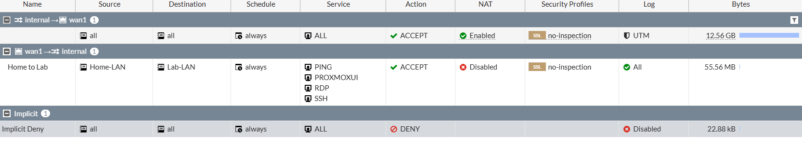

# Network

[Back to README](../README.md)

## Subnets

| Network | Subnet | Gateway |
|---|---|---|
| Home LAN | 192.168.1.0/24 | Home router |
| Lab LAN | 10.10.99.0/24 | FortiGate internal (10.10.99.1) |

## IP plan

| Device | IP | Notes |
|---|---|---|
| FortiGate wan1 | 192.168.1.20 | Faces the home LAN |
| Laptop | 192.168.1.120 | Static, management workstation |
| FortiGate internal | 10.10.99.1 | Lab gateway |
| pve01 | 10.10.99.2 | Proxmox host, cluster `twilight` |
| pve02 | 10.10.99.3 | Proxmox host, cluster `twilight`, see [06](06-pve02-cluster.md) |
| DC01 | 10.10.99.11 | Domain controller, DNS |
| DC02 | 10.10.99.12 | Planned, on pve02 |
| docker01 | 10.10.99.20 | Ubuntu Server, Docker host, see [04](04-docker-host.md). lab-stats on 8083. |
| Clients | 10.10.99.100 to 150 | Reserved for DHCP from DC01 later |

The FortiGate had a DHCP server running on `internal` (10.10.99.100 to 150). Turned it off since every lab device has a static IP. DHCP will run on DC01 once clients are added, so there's only ever one DHCP server on the subnet.

### FortiGate admin access on `internal`

Only **PING** is enabled. FMG-Access, SSH and Security Fabric Connection were removed: the FortiGate is managed from `wan1` (192.168.1.20), so the lab side doesn't need management access. Least privilege.

### `wan2`

Set to static `0.0.0.0` and admin down. Plugging it into the home router let it pull a DHCP address that clashed with the Mac and added a second default route. See [06](06-pve02-cluster.md). Earmarked as an HA heartbeat port later.

### `internal3`

Only links at 100Mbps and was unreliable. Left unused.

## Firewall policies (FortiGate)

### Home to Lab

| Field | Value |
|---|---|
| Incoming / Outgoing | wan1 / internal |
| Source | Home-LAN (192.168.1.0/24) |
| Destination | Lab-LAN (10.10.99.0/24) |
| Services | HTTP, HTTPS, DNS, Nginx Proxy Manager (TCP 81), PROXMOXUI (TCP 8006), SSH, RDP, PING |
| NAT | Off |
| Logging | All sessions |

Web UIs all go through Nginx Proxy Manager on 80 and 443, see [05](05-reverse-proxy.md). NPM 81 and Proxmox 8006 stay as direct ways in if the proxy breaks.

Replaced the original laptop-only rule from [01](01-network-access.md), which has been removed.

### Lab to Internet

| Field | Value |
|---|---|
| Incoming / Outgoing | internal / wan1 |
| Source / Destination | all / all |
| Services | ALL |
| NAT | On |

### Current policy list

## Routing

| Where | Route |
|---|---|
| Laptop | `10.10.99.0/24 via 192.168.1.20` (persistent) |
| Home router (TP-Link, LTE) | Same route on the LAN interface, so all home devices can reach the lab |

## DNS

| Client | DNS server |
|---|---|
| Laptop | Pi-hole (10.10.99.20) |
| docker01 | 1.1.1.1, 8.8.8.8 (Pi-hole runs on it, so it doesn't depend on Pi-hole) |
| DC01 | Itself for lab.twilight. Forwarder to change from 1.1.1.1 to Pi-hole when it's back on. |
| Home router | Unchanged until there's a second Pi-hole |
| Tailscale devices | Split DNS: `twilight.goaround.lol` → Pi-hole, everything else normal |

Pi-hole upstream: Quad9 (filtered, DNSSEC). Every name under `twilight.goaround.lol` resolves to docker01 (NPM) via one Pi-hole wildcard rule, see [05](05-reverse-proxy.md). Older `home.arpa` records from [04](04-docker-host.md#step-7-pi-hole-) still work.

## Internet connection

Home internet is LTE behind CGNAT. The router's WAN IP is in 100.64.0.0/10, so nothing on the internet can start a connection in and port forwarding won't work. Remote access has to dial out, which is why Tailscale is used.

## Remote access

Tailscale runs on pve01 and advertises 10.10.99.0/24 as a subnet route. See [02](02-tailscale-remote-access.md).

| Target | Address |
|---|---|
| Proxmox UI | https://pve01:8006 via Tailscale, or https://pve.twilight.goaround.lol / https://pve02.twilight.goaround.lol on the home network |
| Lab machines | Their 10.10.99.x address via the subnet route |
